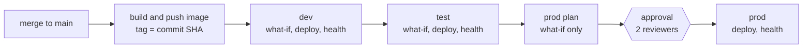

# CI/CD

| Workflow | Trigger | What it does |
|---|---|---|
| [`ci.yml`](ci.yml) | Every pull request to `main`, every push to `main`, and manually | 7 quality and security gates; all are required checks |
| [`cd.yml`](cd.yml) | Every merge to `main` (and manually, for rollbacks) | Build once, then dev → test → prod with an approval before prod |
| [`deploy-environment.yml`](deploy-environment.yml) | Called by `cd.yml` | What-if, deletion guard, deploy, health verification for one environment |

**CD is defined, not executed**, as the assessment requires. It stays switched off until the repository variable `CD_ENABLED` is `true`: until then its jobs are skipped, never failed.

## CI gates, and why each one is essential

Every gate is a **required status check** in the branch protection of `main` (together with one approving review and an up-to-date branch), so nothing merges unless all of them pass.

| # | Gate | Tool | Fails when | Why it is essential here |
|---|---|---|---|---|
| 1 | Build and test | Maven Wrapper, JUnit 5 | Compilation or any of the 107 tests fails | The tests encode the business rules that protect customers: signature verification against the official vectors, exactly-once, no loss before `2xx`, quarantine instead of guessing, no personal data in logs |
| 2 | Container image scan | Trivy | The image has a fixable HIGH or CRITICAL vulnerability | The image is what runs in production; a vulnerable base image is the most common supply-chain risk |
| 3 | SAST | CodeQL (`security-extended`) | A security finding in our code | Internet-facing webhook code handling payment data (injection, unsafe deserialization, logging of sensitive data) |
| 4 | Dependency review | GitHub dependency review | A new dependency has a known HIGH/CRITICAL vulnerability or a GPL/AGPL licence | Stops vulnerable libraries **before** they merge, not after an alert |
| 5 | Secret scan | Gitleaks, full history | A secret is committed outside the allowlisted fictional material | NFR6. PR-214 is exactly this failure: a live secret in `application.yml` |
| 6 | API contracts | Spectral, Ajv, oasdiff | The OpenAPI or the JSON Schema is invalid, or the webhook contract has a **breaking change** against `main` | Providers integrate against the contract; a breaking change must be a new `/v2` (docs/api/README.md) |
| 7 | IaC | Bicep build + strict linter, for dev, test and prod | A template or a parameter file does not compile, or breaks a linter rule (secrets in outputs, hard-coded URLs, unused code…) | Infrastructure changes are code changes: they are validated before merge, not discovered during a deployment |

**Deliberately not in CI**, and why:
- **Mutation testing and coverage thresholds:** a coverage percentage rewards quantity, not the right tests. The tests are reviewed in the pull request instead.
- **DAST against a running instance:** the services are internal; a dynamic scan belongs to the test environment, not to every pull request.
- **Load tests:** they run in the test environment, which has the prod Cosmos DB ceiling (infra/README.md).

**Supply chain:** Dependabot ([`../dependabot.yml`](../dependabot.yml)) opens weekly pull requests for Maven dependencies, the base image and the actions themselves, and each one goes through the same gates. In a production repository, actions are also pinned by commit SHA rather than tag.

## CD: dev → test → prod

**Controls:**

| Control | How |
|---|---|
| **Build once, promote the same artifact** | One image per commit, tagged with its SHA (never `latest`), deployed unchanged to dev, test and prod |
| **Infrastructure and application together** | One Bicep deployment per environment carries both, so an environment is always described by one commit |
| **Plan before change** | Every environment runs `what-if` first and publishes it to the job summary; prod's plan is shown **before** the approval |
| **Deletion guard** | If what-if shows a deletion (someone changed the environment by hand), the deployment stops for a person to look |
| **Approval for prod** | GitHub environment `production`: 2 required reviewers, the author cannot approve their own change, only the `main` branch can deploy |
| **One deployment at a time** | `concurrency: cd-main`, never cancelled half-way |
| **Verify, then trust** | After deploying, the active revision of every Container App must report `Healthy` (driven by the liveness and readiness probes) |
| **Rollback** | Run `cd.yml` manually with the image tag of the last good commit: it skips the build and redeploys that image everywhere |

## Authentication to Azure without stored secrets

The pipeline uses **OpenID Connect**. A job asks GitHub for a short-lived token that says who it is (repository and environment), and Azure exchanges it for an access token. There is no client secret or certificate anywhere.

| GitHub environment | Azure identity | Trusted for (federated credential subject) | Rights |
|---|---|---|---|
| `build` | `id-github-build` | `repo:<owner>/<repo>:environment:build` | `AcrPush` on the shared registry only |
| `dev` | `id-github-deploy-dev` | `repo:<owner>/<repo>:environment:dev` | dev resource group (+ AcrPull grants on the registry) |
| `test` | `id-github-deploy-test` | `repo:<owner>/<repo>:environment:test` | test resource group (+ AcrPull grants on the registry) |
| `prod-plan` | `id-github-plan-prod` | `repo:<owner>/<repo>:environment:prod-plan` | prod resource group: `Reader` plus a custom role with only `Microsoft.Resources/deployments/whatIf/action` |
| `production` | `id-github-deploy-prod` | `repo:<owner>/<repo>:environment:production` | prod resource group (+ AcrPull grants on the registry) |

Each deploy identity has **Contributor** on its own resource group, plus **Role Based Access Control Administrator with a condition** that allows assigning only the roles the template uses (Key Vault Secrets User, Azure Service Bus Data Sender/Receiver, AcrPull; see infra/README.md). Because the template grants `AcrPull` on the shared registry, the same conditional role is also needed on that registry. Cosmos DB data roles are not Azure RBAC and are covered by Contributor on the account. A job in `dev` cannot obtain the prod identity, because the federated credential only trusts tokens issued for the `production` environment, and that environment only runs after approval.

Each GitHub environment stores **variables, not secrets**: `AZURE_CLIENT_ID`, `AZURE_TENANT_ID`, `AZURE_SUBSCRIPTION_ID`, `AZURE_RESOURCE_GROUP` (and `ACR_NAME` in `build`). They are identifiers; none of them grants access on its own.

## To switch CD on (not done in this assessment)

1. Create the identities and federated credentials above (platform team).
2. Create the GitHub environments `build`, `dev`, `test`, `prod-plan` and `production` with their variables; on `production`, add the required reviewers and restrict it to `main`.
3. Protect `main`: pull requests only, 1 approval, the 7 CI jobs as required checks.
4. Set the repository variable `CD_ENABLED = true`.

## Known gaps

- Only `payment-intake` has an image in this repository. `salesforce-writer` and `payment-ops` are designed but not built, so a real first deployment needs their images (same Dockerfile pattern).
- CD has **not run** (it needs Azure). The workflows pass actionlint, and these CI steps were run locally with the same tools and versions: Bicep build and lint, Spectral, Ajv, Gitleaks (history of `main`), Maven `verify`, and building and starting the image (health `UP`, non-root user, `401` for an unsigned webhook). Trivy could not be run locally (its vulnerability database could not be downloaded from this machine), so gate 2 is first exercised on GitHub.
- The base image is referenced by tag (`eclipse-temurin:21-jre-alpine`); in production it is pinned by digest and updated by Dependabot.
