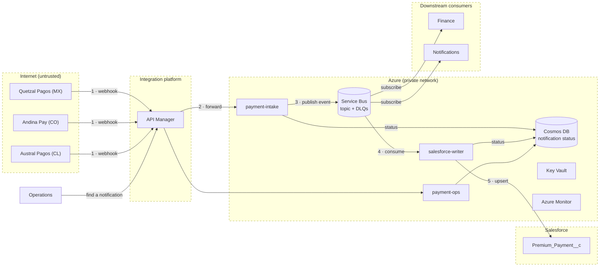
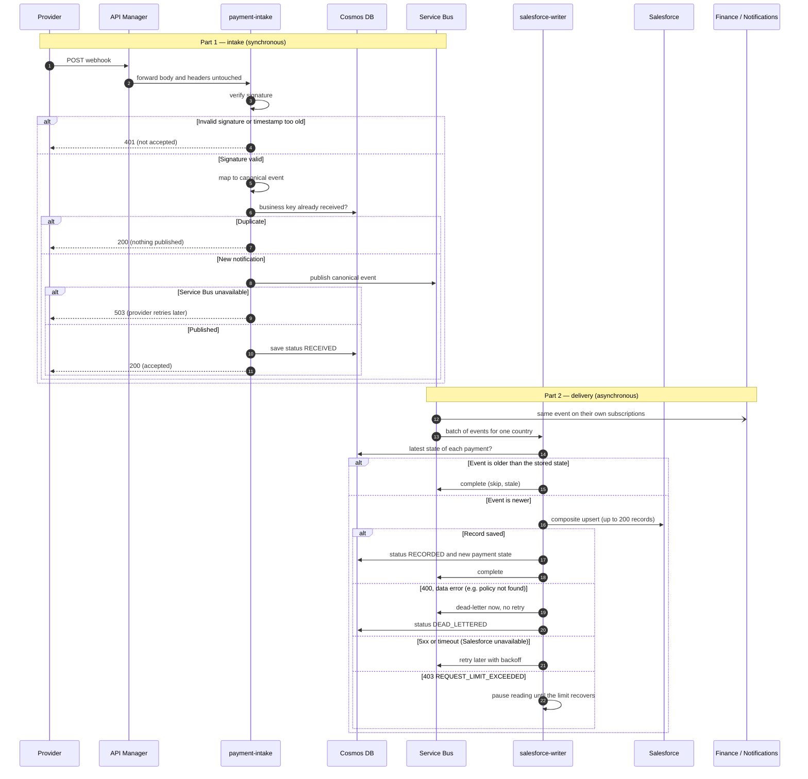
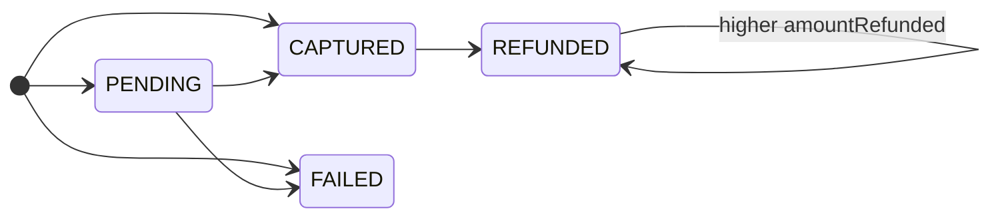

# Solution Design — Premium Payment Notifications

## 1. Context diagram

Dashed boxes are **trust boundaries**. Numbers follow one notification from the provider to Salesforce.



Not drawn, to keep the diagram readable: every Azure service reads its secrets from **Key Vault** with a managed identity and sends telemetry to **Azure Monitor**.

### 1.1 Components

| Component | What it does |
|---|---|
| **API Manager** | Single public entry point. Forwards the webhook body untouched to `payment-intake`. Also publishes the internal Ops API. |
| **payment-intake** | Verifies the provider's signature, translates the payload into the canonical event, publishes it and only then answers `2xx` to the provider. |
| **Service Bus** | Durable buffer between the providers and Salesforce. One subscription per consumer, each with its own dead-letter queue. The Salesforce subscriptions use sessions per payment (see 4.4). |
| **salesforce-writer** | Reads events, discards stale ones and upserts `Premium_Payment__c` in batches. |
| **Cosmos DB** | Status of each notification (received, recorded, failed, dead-lettered) and latest state of each payment. |
| **payment-ops** | Lets operations look up a notification by its provider id (FR7). |
| **Key Vault** | Provider webhook secrets and the Salesforce client secret. |
| **Azure Monitor** | Logs, traces and alerts per country, without payer personal data. |

### 1.2 Trust boundaries

| Boundary | Main control |
|---|---|
| Internet → API Manager | TLS, then the provider's signature, verified in `payment-intake` |
| API Manager → Azure | Private network plus a machine-to-machine token from the IdP |
| Inside Azure | Managed identities with least privilege. No keys or connection strings. |
| Azure → Salesforce | OAuth client credentials, dedicated integration user |
| Operations → payment-ops | Corporate SSO with a `payments-ops` role. Responses carry no personal data. |

## 2. Sequence diagram

One notification, in two parts:

- **Part 1 (synchronous):** must finish inside the provider's timeout (5 s for Andina, 10 s for Quetzal and Austral).
- **Part 2 (asynchronous):** runs at Salesforce's pace and is where retries happen.



### 2.1 Failure paths

| Case | What happens | Why |
|---|---|---|
| Invalid signature or old timestamp | `401`, nothing is stored or published | The request is not authentic, so it is not accepted (FR1). |
| Unknown provider state | `200`, sent to the quarantine queue, alert | Never guess a status; keep the notification safe until the adapter is fixed. |
| Duplicate | `200` without publishing again | The provider stops retrying, and the payment is not counted twice (FR4). |
| Service Bus unavailable | `503`, the provider retries | We only answer `2xx` when the event is safely stored (NFR3). |
| Late or out-of-order event | Skipped by `salesforce-writer` | A refunded payment can never go back to captured (FR5). |
| Salesforce data error (`400`) | Dead-lettered at once | Retrying cannot fix bad data and only wastes API budget. |
| Salesforce unavailable (`5xx`) | Circuit breaker pauses reading, then resumes | Outages last 5 to 90 minutes; the queue holds the events meanwhile. |
| API limit reached (`403`) | Consumption paused | Retrying would make the shared org-wide limit worse for every integration. |

## 3. Canonical payment event

Every provider notification is translated into this single event (FR2). It never contains payer personal data (names, national ids, emails) or payment tokens.

### 3.1 Fields

| Field | Type | Required | Description |
|---|---|---|---|
| `schemaVersion` | string | yes | Version of this contract, e.g. `"1.0"`. |
| `eventId` | string | yes | Deterministic business key of the event: `<paymentKey>:<status>`, or `<paymentKey>:REFUNDED:<amountRefunded>` for refunds (see 3.6). The same business event always gets the same `eventId`, even when the provider retries with a new id. |
| `paymentKey` | string | yes | `<PROVIDER>-<providerTransactionId>`, e.g. `ANDINA-TRX-CO-5521907`. Written to `Payment_Key__c` (max 80 chars). |
| `country` | string | yes | `MX`, `CO`, `CL`. |
| `provider` | string | yes | `Quetzal`, `Andina`, `Austral`. |
| `providerTransactionId` | string | yes | Charge, transaction or payment id at the provider. |
| `providerEventId` | string | yes | The provider's id for this notification. Written to `Last_Event_Id__c`. |
| `policyNumber` | string | yes | Normalized to `POL-<country>-<9 digits>`, upper case. |
| `status` | string | yes | `PENDING`, `CAPTURED`, `FAILED`, `REFUNDED`. |
| `amount` | string | yes | Decimal in the **major unit** (`"1250.00"`), as a string to avoid rounding. |
| `amountRefunded` | string | no | Required for `REFUNDED`. **Cumulative** amount refunded on the payment so far, major unit. |
| `currency` | string | yes | ISO 4217, upper case: `MXN`, `COP`, `CLP`. |
| `statusChangedAt` | string | yes | Time of the state change at the provider, ISO-8601 UTC. Used to resolve ordering (FR5). |
| `receivedAt` | string | yes | Time Meridian received the notification, ISO-8601 UTC. Used to measure freshness (NFR2). |
| `correlationId` | string | yes | UUID created by `payment-intake`, carried end to end (NFR7). |

### 3.2 Example

The Andina sample `02-transaccion-aprobada.json` becomes:

```json
{
  "schemaVersion": "1.0",
  "eventId": "ANDINA-TRX-CO-5521907:CAPTURED",
  "paymentKey": "ANDINA-TRX-CO-5521907",
  "country": "CO",
  "provider": "Andina",
  "providerTransactionId": "TRX-CO-5521907",
  "providerEventId": "ntf-8f1c2a77",
  "policyNumber": "POL-CO-000187342",
  "status": "CAPTURED",
  "amount": "185000.00",
  "currency": "COP",
  "statusChangedAt": "2026-11-28T19:03:09Z",
  "receivedAt": "2026-11-28T19:03:11Z",
  "correlationId": "7f3a0c2e-5d1b-4c8e-9a2f-1b6e0d4c3a21"
}
```

Its retry (`03-transaccion-aprobada-reintento.json`) has a different `notificacion_id` but produces the **same `eventId`**, so it is detected as a duplicate.

### 3.3 Field mapping

| Canonical field | Quetzal (MX) | Andina (CO) | Austral (CL) |
|---|---|---|---|
| `providerEventId` | `id` | `notificacion_id` (changes on every retry) | `eventId` |
| `providerTransactionId` | `data.charge.id` | `transaccion.id` | `payment.paymentId` |
| `policyNumber` | `data.charge.reference` | `transaccion.referencia`, **normalized** (since API 2.3 it arrives as typed by the payer) | `payment.policyNumber` |
| `amount` | `data.charge.amount` ÷ 100 (integer in centavos) | `transaccion.valor` (already major unit) | `payment.amount` (CLP has no decimals) |
| `amountRefunded` | `data.charge.amount_refunded` ÷ 100 | `transaccion.valor` when `REVERSADA` | `payment.amount` when `PAYMENT_REVERSED` |
| `currency` | `data.charge.currency`, upper-cased (`mxn` → `MXN`) | `transaccion.moneda` | `payment.currency` |
| `statusChangedAt` | `paid_at` (captured), `refunded_at` (refunded), `created` (failed), Unix seconds → UTC | `transaccion.fecha_transaccion`, offset → UTC | `payment.occurredAt` |
| Ignored | `payment_method`, `customer` | `pagador`, `medio_pago`, `canal`, unknown fields | `payer`, `sentAt` |

### 3.4 State mapping

| Canonical `status` | Salesforce `Status__c` | Quetzal `type` | Andina `transaccion.estado` | Austral `eventType` |
|---|---|---|---|---|
| `PENDING` | `Pending` | — | `PENDIENTE` | — |
| `CAPTURED` | `Captured` | `charge.succeeded` | `APROBADA` | `PAYMENT_CONFIRMED` |
| `FAILED` | `Failed` | `charge.failed` | `RECHAZADA` | `PAYMENT_REJECTED` |
| `REFUNDED` | `Refunded` | `charge.refunded` | `REVERSADA` | `PAYMENT_REVERSED` |

An **unknown or missing** provider state is never guessed, defaulted or left empty, because a wrong `Status__c` changes the customer's coverage through the Salesforce flow. Instead:

1. The signature is valid, so the notification is authentic: `payment-intake` answers `200` and stores it durably.
2. It is **not** sent to Salesforce. It goes to the `payments-quarantine` queue with reason `UNKNOWN_PROVIDER_STATUS` (see 5.2), and an alert is raised.
3. Once the adapter supports the new state, operations replays it. The replay goes through the same ordering check as any other event.

Rejecting it with a non-`2xx` code was discarded. It would depend on the provider's retry window, and Andina retries only 5 times in 24 hours, so a fix that took longer would lose the notification.

### 3.5 Policy number normalization

The Andina 2.3 change means `referencia` can arrive as `000215560` or `pol-co-000198004` (see INC-0412). The Andina adapter normalizes it:

1. Trim and upper-case.
2. If it matches `POL-CO-\d{9}`, use it.
3. If it is exactly 9 digits, prefix `POL-CO-`.
4. Otherwise, publish it as received. The `salesforce-writer` dead-letters it with reason `POLICY_NOT_FOUND` for manual review.

### 3.6 Refunds, including partial refunds

Quetzal can refund a charge **partially, more than once**. Each refund is a new `charge.refunded` event for the same charge. A key of `<paymentKey>:REFUNDED` would mark the second refund as a duplicate and drop it. That is why the refund key includes the cumulative amount refunded:

| Event (charge of MXN 1,250.00) | `amount_refunded` | `eventId` | Result |
|---|---|---|---|
| First partial refund | 50000 | `QUETZAL-ch_7Hk2Lm9QpZ:REFUNDED:500.00` | Processed |
| Retry of the first refund | 50000 | `QUETZAL-ch_7Hk2Lm9QpZ:REFUNDED:500.00` | Duplicate, skipped |
| Second partial refund | 125000 | `QUETZAL-ch_7Hk2Lm9QpZ:REFUNDED:1250.00` | Processed |

- `amount_refunded` is assumed to be **cumulative**, not the amount of the latest refund. The sample `03-charge-refunded.json` is consistent with this: a full refund carries `amount_refunded = amount`.
- Andina (`REVERSADA`) and Austral (`PAYMENT_REVERSED`) do not document partial reversals, so they are treated as full: `amountRefunded = amount`. The same key rule applies to every provider.
- Because the amount only grows, a refund with a **lower** cumulative amount than the one already applied is stale and is skipped (see the ordering strategy).

**Open question for the Salesforce team.** `Premium_Payment__c` has no field for the refunded amount. Until one exists, any refund, partial or full, is written as `Status__c = Refunded`, and the exact amount travels in the canonical event for Finance. This can make the flow treat a partial refund as a full one when it recalculates `Overdue_Amount__c`. We propose adding `Amount_Refunded__c` and having the flow use it.

## 4. Idempotency and ordering

Two problems, two answers:

- **Duplicates (FR4):** the same business event arrives more than once. It is solved with an **idempotency key**.
- **Out-of-order events (FR5):** an older event arrives after a newer one. It is solved with an **ordering rule** against the latest applied state.

### 4.1 Idempotency key per provider

The key is the canonical `eventId`. It is built from **business identifiers**, never from the id of the delivery attempt.

| Provider | Idempotency key | Why not the provider's event id |
|---|---|---|
| Quetzal (MX) | `QUETZAL-<data.charge.id>:<status>` (refunds: `:REFUNDED:<amountRefunded>`) | `id` is stable across retries, but the business key also covers a resent event with a different id. `id` is kept as `providerEventId` for traceability. |
| Andina (CO) | `ANDINA-<transaccion.id>:<status>` (refunds: `:REFUNDED:<amount>`) | `notificacion_id` **changes on every retry**, so it cannot detect duplicates. The spec itself says `transaccion.id` + `estado` identifies the business event. |
| Austral (CL) | `AUSTRAL-<payment.paymentId>:<status>` (refunds: `:REFUNDED:<amount>`) | `eventId` is stable across retries. The business key keeps the rule the same for every provider. |

The record identity in Salesforce is `paymentKey` (`<PROVIDER>-<providerTransactionId>`). It is written to `Payment_Key__c`, so one payment is always **one** `Premium_Payment__c`, whatever its status.

### 4.2 Where it is enforced

Each layer covers a gap the previous one can leave:

| # | Layer | How | Gap it covers |
|---|---|---|---|
| 1 | `payment-intake` | Looks up `eventId` in Cosmos DB `notifications` before publishing. If found, answers `200` without publishing. | The ≈3% provider duplicates (NFR1) never reach the queue. |
| 2 | Service Bus | Duplicate detection with `messageId = eventId` (24 h window). | A crash between "publish" and "save status" in layer 1: the provider retries, the publish repeats, the broker drops it. |
| 3 | `salesforce-writer` | Ordering rule (4.3) against Cosmos DB `payment-state`. An event that is not newer is skipped. | Duplicates older than 24 h, and replays from the DLQ. |
| 4 | Salesforce | Upsert by `Payment_Key__c`. | Even if everything above failed, repeating the same upsert updates the same record. It never creates a second payment. |

Finance and Notifications receive events **at least once and in any order**. The event contract asks them to deduplicate by `eventId` and to apply the same ordering rule.

### 4.3 Ordering rule

A payment can only move forward in its lifecycle:



Each status has a **rank**: `PENDING` = 1, `CAPTURED` and `FAILED` = 2, `REFUNDED` = 3. For each incoming event, `salesforce-writer` compares it with the stored state of the same `paymentKey`:

| # | Condition | Decision |
|---|---|---|
| 1 | No stored state | Apply |
| 2 | Higher rank than stored | Apply |
| 3 | Lower rank than stored | Skip, stale |
| 4 | Same status (`REFUNDED` with a higher `amountRefunded`) | Apply |
| 5 | Same status, anything else | Skip, duplicate |
| 6 | `CAPTURED` vs `FAILED` | Do not guess. Dead-letter with reason `CONFLICTING_STATE` and alert. |

The rule uses the **lifecycle rank**, not only timestamps. Provider clocks and `statusChangedAt` are still stored and shown to operations, but rank is what decides. Rank cannot be fooled by clock skew, and a refund is always the last word.

**Examples** with the Andina samples for `TRX-CO-5521907`:

| Arrival order | Stored state before | Decision | Salesforce shows |
|---|---|---|---|
| `PENDIENTE` → `APROBADA` → `REVERSADA` (normal order) | none → PENDING → CAPTURED | apply, apply, apply | Refunded ✅ |
| `APROBADA` (retry) arrives again | CAPTURED | skip, duplicate (rule 5) | Captured ✅ |
| `REVERSADA` arrives **before** `APROBADA` | none → REFUNDED | apply, then skip `APROBADA` (rule 3) | Refunded ✅, never Captured |
| `PENDIENTE` arrives last | CAPTURED | skip, stale (rule 3) | Captured ✅ |

In the third case, the record is created directly as `Refunded`. It was never `Captured` in Salesforce, so the flow neither reinstates the policy nor suspends it again, which is the correct outcome: the money was returned.

### 4.4 Concurrency: one payment, one writer at a time

The check and the write are two steps. If two events of the same payment were processed in parallel, both could pass the check, and the older one could reach Salesforce last. To prevent it:

- The `sf-writer-*` subscriptions use **Service Bus sessions** with `SessionId = paymentKey`. Events of the same payment are processed one at a time; different payments are processed in parallel and batched together.
- Within a batch, at most **one record per `paymentKey`** is sent (the winner under 4.3). Salesforce rejects a composite request with the same external id twice.
- The `payment-state` document is updated **after** Salesforce confirms, with a conditional write (ETag). If Salesforce fails, the state is unchanged, and the retry evaluates the event again.

Replays from the DLQ follow the same path, so they can never overwrite a newer state.

## 5. Error handling

The principle: **retry only what time can fix**. Everything else stops at once, with a clear reason, in a place operations can see.

### 5.1 What is retried, how and for how long

**In `payment-intake` (synchronous, inside the provider's timeout)**

| Error | Retried? | How | Then |
|---|---|---|---|
| Invalid signature or old timestamp | No | `401` | Nothing is stored. An alert fires if the rate is abnormal: either an attack or a secret rotation went wrong. |
| Service Bus or Cosmos DB unavailable | By the **provider** | `503`. One quick internal retry only if time allows (Andina: 5 s budget). | The provider retries with its own policy: Quetzal up to 3 days, Andina 5 times in 24 h, Austral 8 times in 48 h. |
| Valid signature, but unknown state or unreadable payload | No | `200`, sent to quarantine (5.2) | Reviewed and replayed once the adapter is fixed. |

**In `salesforce-writer` (asynchronous)**

| Salesforce answer | Retried? | How | For how long | Then |
|---|---|---|---|---|
| `5xx` or timeout | Yes | **Circuit breaker** per country: after 5 consecutive failures, stop reading the queue and probe every 30 s. Events wait in the queue without spending deliveries. | Until Salesforce recovers. Outages last 5–90 min (`API_CONSTRAINTS.md`). | Resume automatically. An event older than **24 h** goes to the DLQ (`RETRIES_EXHAUSTED`). |
| `400 UNABLE_TO_LOCK_ROW` | Yes | Rescheduled with exponential backoff: 5 s, 15 s, 1 min, 5 min, 15 min | 5 attempts | DLQ (`RETRIES_EXHAUSTED`) |
| `401 INVALID_SESSION_ID` | Once | Get a new token and retry once | 1 attempt | If it fails again: open the circuit and alert. It is a credentials problem, not a payment problem. |
| `403 REQUEST_LIMIT_EXCEEDED` | Yes, later | **Pause all countries.** The limit is org-wide, so retrying hurts every integration. Probe every 5 min. | Until usage falls under the limit | Resume automatically. Alert from the first `403`. |
| `400` data errors: `INVALID_FIELD`, `FIELD_CUSTOM_VALIDATION_EXCEPTION`, `REQUIRED_FIELD_MISSING` | **No** | — | — | DLQ **at once** (`POLICY_NOT_FOUND` or `SALESFORCE_VALIDATION`) |
| Unexpected error in our code | Yes | Service Bus redelivery | Max delivery count 10 | DLQ (`MaxDeliveryCountExceeded`) |

Two details matter here:

- **Composite upserts** use `allOrNone: false`, so each record of a batch is handled on its own. One bad record does not block the other 199.
- **No immediate redelivery for errors that time cannot fix.** In INC-0412, each `400` was retried 10 times in about 2 seconds. That produced 43,120 useless calls and fixed nothing.

### 5.2 Dead-letter queue and quarantine

| Queue | Who writes to it | What it holds |
|---|---|---|
| DLQ of each `sf-writer-*` subscription | `salesforce-writer` | Canonical events that could not be recorded in Salesforce |
| DLQ of `finance` and `notifications` | The consumers themselves | Their own failures. They own them. |
| `payments-quarantine` | `payment-intake` | Authentic notifications that cannot be mapped (unknown state, unreadable payload). Payer fields are removed before storing. |

Every dead-lettered or quarantined message carries:

- A **reason code**: `POLICY_NOT_FOUND`, `SALESFORCE_VALIDATION`, `CONFLICTING_STATE`, `RETRIES_EXHAUSTED`, `UNKNOWN_PROVIDER_STATUS`, `INVALID_PAYLOAD` or `MaxDeliveryCountExceeded`.
- The `correlationId`, the provider ids and the last error. Never payer personal data.

The notification's status in Cosmos DB becomes `DEAD_LETTERED` with the same reason, so operations sees it without searching logs (FR7). An alert fires as soon as **any** DLQ or quarantine of **any** country is not empty. In INC-0412 only Mexico had one.

### 5.3 Safe replay

Replays are done only through `payment-ops`, never by hand in the queue explorer.

1. **Fix the cause first.** For example, deploy the policy number normalization. Replaying before the fix only fills the DLQ again.
2. **Select** messages by country, reason and time window.
3. **Dry run.** Show how many events would be applied, skipped as stale or skipped as duplicates. Nothing is written.
4. **Replay** at a limited rate (for example 1,000 records per minute) so the Salesforce API budget is protected.
5. **Only to the subscription of origin.** Each replayed message carries a `replayTarget` property, and only that subscription's filter accepts it. Finance and Notifications do not receive the event twice.
6. **New `messageId`, same `eventId`.** The replay gets `messageId = <eventId>:replay:<n>` so Service Bus duplicate detection does not drop it. The `eventId` stays the same, so the ordering rule (4.3) still decides. A replayed `CAPTURED` can never overwrite a newer `REFUNDED`.
7. **Audit.** Each replay records who ran it, when, which messages and the outcome. It requires the `payments-ops-replay` role.

Because the ordering rule decides every write, the order of the replay does not matter. Replaying an `APROBADA` and its `REVERSADA` together always ends as `Refunded`.

## 6. Capacity

### 6.1 Volume (NFR1)

| | Mexico (45%) | Colombia (40%) | Chile (15%) | Total |
|---|---|---|---|---|
| Normal day | 6,750 | 6,000 | 2,250 | 15,000 |
| Month-end peak day | 54,000 | 48,000 | 18,000 | 120,000 |
| Burst (15 min) | 18 /s | 16 /s | 6 /s | 40 /s → 36,000 in 15 min |
| After removing ≈3% duplicates (peak day) | | | | ≈ 116,400 events to Salesforce |

**Intake and Azure are not the bottleneck.** At 40/s, with roughly 50 ms of work per request (signature, one Cosmos DB read, one Service Bus send, one write), `payment-intake` needs about 2 requests in flight. Two replicas, for availability, are already enough. Service Bus and Cosmos DB handle this rate with a minimal configuration (sizes in `docs/infra/AZURE_SERVICES.md`).

**Salesforce is the bottleneck.** The rest of the section is about it.

### 6.2 Why not one call per record

| | One upsert per record | Composite upsert, up to 200 records |
|---|---|---|
| API calls on a peak day | ≈ 116,400 (**78%** of the 150,000 budget), before any retry | ≈ 25,000 (**17%**) at most, see 6.3 |
| Throughput with the 25-concurrent-request cap | 25 ÷ 1.2 s (p95) ≈ **21 /s**. Under load (8 s): ≈ 3 /s. | One call carries up to 200 records |
| Burst of 40/s | **Does not fit**: it needs ≈ 48 requests in flight, above the cap of 25 | 3 calls every 10 s |

One call per record exhausts the budget and cannot absorb the burst. This is decided in ADR-0001.

### 6.3 Batching rule and API budget (NFR5)

`salesforce-writer` sends a batch per country **when it has 200 records or 10 seconds have passed**, whichever comes first.

- **Upper bound per day:** 3 countries × 8,640 ten-second windows = **25,920 calls (17% of the budget)**. This holds **regardless of volume**, as long as no country exceeds 200 records in 10 s (20/s). In the burst, Mexico reaches 180 per 10 s, so even the burst fits in one call per country per window.
- **Normal day:** many windows are empty, which gives ≈ **11,000 calls (7%)**.
- **Extra calls:** token renewal every ≈ 2 h, circuit-breaker probes during outages (≈ 540 for a 90-minute outage in all three countries) and replays. Each is in the hundreds, not thousands.
- **Concurrency:** 3 calls in flight in normal operation and at most 5 while draining a backlog. That is well below the cap of 25 and leaves room for retries.

**Budget guard.** `salesforce-writer` counts its own calls in a rolling 24 h window:

| Calls used | Action |
|---|---|
| 60% | Alert to on-call |
| 80% | Widen the batch window from 10 s to 60 s (at most 4,320 calls per day) |
| 95% | Stop sending, except replays approved by operations. Alert the Salesforce team. |

The guard keeps the integration from consuming the **org-wide** limit, which would block every other integration (`403 REQUEST_LIMIT_EXCEEDED`). For comparison, in INC-0412 v1 reached 66% of the budget on an ordinary day.

### 6.4 Salesforce outages (97% availability)

97% availability means about **21.6 hours of unavailability per month**, in windows of 5 to 90 minutes.

| Scenario | Events waiting in the queue | Time to drain after recovery (5 calls × 200 records every ≈ 4 s ≈ 250 records/s) |
|---|---|---|
| 90-minute outage on a peak day (average 1.39/s) | ≈ 7,500 | ≈ 30 s |
| Worst case: the outage covers the whole 15-min burst and lasts 90 min | ≈ 42,000 | ≈ 3 min (≈ 210 calls) |

The queue absorbs the outage with no data loss: the events wait in Service Bus, and no notification is rejected to the provider. Draining is limited to 5 concurrent calls so that the record-triggered flow in Salesforce does not receive more load than it can handle.

### 6.5 Freshness (NFR2)

**Normal path:** intake under 1 s, plus up to 10 s waiting for the batch, plus about 4 s for the Salesforce call (p95). That gives **about 15 s end to end**, far below 5 minutes.

What really decides freshness is **Salesforce availability**:

| Target | Assessment |
|---|---|
| 95% within 5 min | ✅ Met. Only events that arrive during an outage are late. If outages take 3% of the time, about 97% of events are within 5 minutes. |
| 99.5% within 1 h | ⚠️ **Depends on outage length.** Only outages longer than 60 minutes delay events more than 1 hour. If every outage lasted 90 minutes (worst case, about 14 per month), about 1% of events would be over 1 hour, giving **≈ 99.0%**. With outages under 60 minutes, the target is met. |

The integration cannot be fresher than its system of record. Our proposal:

1. Measure the SLO with and without Salesforce's declared unavailability, per country (see `OPERATIONS.md`).
2. Agree with the Salesforce team on the outage-length distribution, or accept that the 1-hour target excludes outages longer than 60 minutes.
3. During long outages, the payment state is still visible to operations in Cosmos DB (`payment-ops`), so the contact center can confirm a payment before Salesforce shows it.

## 7. Data

Salesforce remains the **system of record** for payments. Outside Salesforce we keep only the **operational state** the integration needs to work. The store is **Azure Cosmos DB for NoSQL** (the choice is justified in ADR-0002).

### 7.1 What we persist and why

| Container | One document per | Needed for |
|---|---|---|
| `notifications` | Business event (`eventId`) | Detect duplicates at intake (FR4). Let operations find a notification and its status (FR7). |
| `payment-state` | Payment (`paymentKey`) | The ordering rule: the latest state applied to Salesforce (FR5). |
| `replay-audit` | Replay run | Who replayed what, when, and with what outcome (5.3). |

What we **do not** persist:
- **Raw provider payloads.** They contain payer personal data, and once the signature is verified and the event mapped we no longer need them.
- **Payer names, national ids, emails or payment tokens.**

### 7.2 Document model

**`notifications`**: one document per business event. Provider retries are appended to `attempts` instead of creating new documents, so operations can search by any provider id, including the `notificacion_id` of an Andina retry.

```json
{
  "id": "ANDINA-TRX-CO-5521907:CAPTURED",
  "paymentKey": "ANDINA-TRX-CO-5521907",
  "country": "CO",
  "provider": "Andina",
  "providerTransactionId": "TRX-CO-5521907",
  "policyNumber": "POL-CO-000187342",
  "status": "CAPTURED",
  "amount": "185000.00",
  "currency": "COP",
  "statusChangedAt": "2026-11-28T19:03:09Z",
  "correlationId": "7f3a0c2e-5d1b-4c8e-9a2f-1b6e0d4c3a21",
  "processingStatus": "RECORDED",
  "reason": null,
  "lastError": null,
  "recordedAt": "2026-11-28T19:03:24Z",
  "attempts": [
    { "providerEventId": "ntf-8f1c2a77", "receivedAt": "2026-11-28T19:03:11Z", "result": "ACCEPTED" },
    { "providerEventId": "ntf-c02d9e13", "receivedAt": "2026-11-28T19:08:11Z", "result": "DUPLICATE" }
  ],
  "ttl": 15552000
}
```

`processingStatus` takes one of five values:

| Value | Meaning |
|---|---|
| `RECEIVED` | Accepted and published, waiting for Salesforce |
| `RECORDED` | Written to Salesforce |
| `SKIPPED` | Not applied because it was stale or a duplicate under the ordering rule (4.3) |
| `FAILED` | Last attempt failed, still being retried |
| `DEAD_LETTERED` | In a DLQ or in quarantine, with `reason` |

`lastError` holds a sanitized error code and message, never a payload.

**`payment-state`**: one small document per payment, read and written only by key.

```json
{
  "id": "ANDINA-TRX-CO-5521907",
  "paymentKey": "ANDINA-TRX-CO-5521907",
  "status": "REFUNDED",
  "statusRank": 3,
  "amountRefunded": "185000.00",
  "statusChangedAt": "2026-12-03T14:15:40Z",
  "lastEventId": "ANDINA-TRX-CO-5521907:REFUNDED:185000.00",
  "updatedAt": "2026-12-03T14:15:55Z",
  "ttl": 34560000
}
```

Updates use the document's `_etag` (optimistic concurrency, 4.4).

### 7.3 Keys, partitioning and indexes

| Container | `id` | Partition key | Indexed paths | Typical access |
|---|---|---|---|---|
| `notifications` | `eventId` | `/paymentKey` | `providerTransactionId`, `attempts[].providerEventId`, `processingStatus`, `country`, `statusChangedAt` | Point read by `id` (intake). Query by provider id or by status and country (operations). |
| `payment-state` | `paymentKey` | `/paymentKey` | **None** (indexing disabled) | Point read and conditional replace by `id` only |
| `replay-audit` | Run id | `/country` | `startedAt`, `user` | Low volume, operations only |

- **Partitioning by `paymentKey`** spreads writes evenly across thousands of payments: there are no hot partitions, even at month-end. All events of one payment live in the same partition, so intake and `salesforce-writer` do single-partition point operations of about 1 RU each.
- **Operations queries** by `providerEventId` cross partitions. That is acceptable, because they are a few manual queries per day and use the index. A lookup by provider transaction id does not, because `paymentKey` is built from it.
- **Disabling indexing** on `payment-state` makes each write cheaper, since it is only ever read by key.

### 7.4 Retention

| Container | Retention (TTL) | Why |
|---|---|---|
| `notifications` | **180 days** | Covers operational investigations, contact-center questions and most chargeback windows. Salesforce keeps the permanent record, so a shorter retention serves data minimization under each country's data protection law. |
| `payment-state` | **400 days, renewed on each update** | It must outlive any late event for the same payment. Provider retries last at most 3 days, but reversals and chargebacks can arrive months later. If the state expired too early, a late old event would look new. |
| `replay-audit` | **2 years** | Audit evidence of manual actions on payment data. |

TTL is native in Cosmos DB, so documents expire automatically without purge jobs.

### 7.5 Size

| | Volume | Size |
|---|---|---|
| Events per month (4 peak days at 120,000 + 26 days at 15,000) | ≈ 870,000 | — |
| `notifications` within 180 days | ≈ 5.2 million documents × ≈ 1 KB | ≈ **5 GB** |
| `payment-state` | Fewer documents than events (2–3 events per payment) × ≈ 0.3 KB | ≈ **1–2 GB** |

This is a small store. Its cost is driven by throughput at peak (RU/s), not by storage. It is sized in `docs/infra/AZURE_SERVICES.md`.

### 7.6 Security of the data

- Private endpoint only, public network access disabled.
- Microsoft Entra ID data-plane roles per managed identity: `payment-intake` writes `notifications`; `salesforce-writer` writes `notifications` and `payment-state`; `payment-ops` only reads, except for `replay-audit`. No account keys are used.
- Encryption at rest by default.
- `policyNumber` is a business identifier, not payer data, but it can be linked to a customer. Access is therefore limited to the `payments-ops` role, and it is never written to logs.

## 8. Operations: finding a notification (FR7)

Operations finds any notification and its processing status through the **Payment Ops API**, served by `payment-ops` from Cosmos DB. Nobody has to search raw logs.

### 8.1 How to find a notification

The API is published in the API Manager on the **internal** gateway only.

| Question from operations | Request |
|---|---|
| "The customer's receipt shows transaction `TRX-CO-5603318`" | `GET /ops/v1/payments?provider=Andina&providerTransactionId=TRX-CO-5603318` |
| "Andina says it sent notification `ntf-c02d9e13`" | `GET /ops/v1/notifications?provider=Andina&providerEventId=ntf-c02d9e13` |
| "What is stuck in Colombia since Saturday?" | `GET /ops/v1/notifications?country=CO&processingStatus=DEAD_LETTERED&from=2026-11-28` (paged) |
| "Follow one event end to end" | `GET /ops/v1/notifications/{eventId}` returns the `correlationId`, which opens the trace in Application Insights |
| "Replay these messages" | `POST /ops/v1/replays` with `dryRun: true` first (see 5.3) |

The provider transaction id is the main entry point, because it is the one printed on the receipts customers send to the contact center.

**Example answer.** This is what the API would have shown for a payment of INC-0412 in v1, which did not normalize the policy number. In this design, `000215560` is normalized to `POL-CO-000215560` (3.5) and the payment is recorded.

```json
{
  "paymentKey": "ANDINA-TRX-CO-5603318",
  "country": "CO",
  "policyNumber": "000215560",
  "currentState": null,
  "events": [
    {
      "eventId": "ANDINA-TRX-CO-5603318:CAPTURED",
      "status": "CAPTURED",
      "amount": "212000.00",
      "currency": "COP",
      "processingStatus": "DEAD_LETTERED",
      "reason": "POLICY_NOT_FOUND",
      "attempts": 1,
      "receivedAt": "2026-11-29T04:41:07Z",
      "correlationId": "7f3a0c2e-…"
    },
    {
      "eventId": "ANDINA-TRX-CO-5603318:REFUNDED:212000.00",
      "status": "REFUNDED",
      "processingStatus": "DEAD_LETTERED",
      "reason": "POLICY_NOT_FOUND",
      "receivedAt": "2026-11-29T21:02:31Z",
      "correlationId": "0e88c7d5-…"
    }
  ]
}
```

With one query, operations sees:

- that the payment never reached Salesforce (`currentState: null`);
- why (`POLICY_NOT_FOUND`, with a policy number in the wrong format);
- that it was later reversed, so a replay must end as `Refunded`.

During INC-0412 this took hours of log searching.

### 8.2 How access is secured

| Control | How |
|---|---|
| Not on the internet | Published only on the API Manager's internal gateway. `payment-ops` has internal ingress only. |
| Authentication | Meridian IdP (OIDC) with SSO and MFA. The JWT is validated by the API Manager and again by `payment-ops`. |
| Authorization by role | `payments-ops-read`: lookups (operations, on-call, contact-center leads). `payments-ops-replay`: replays (Payments Integration squad only). |
| No personal data in answers | Responses never contain payer names, national ids, emails or tokens. These fields are not stored, so they cannot leak. |
| Least privilege behind the API | Lookups use a **read-only** managed identity on Cosmos DB. Only replays may send to Service Bus. |
| Audit | Every request is logged with the user, the filter and the time (Log Analytics). Every replay is also recorded in `replay-audit`. |
| Abuse protection | Rate limit per user and page size limit in the API Manager. |
| No direct access to production data | Humans do not use the Cosmos DB or Service Bus explorers in production. Exceptions are break-glass, through just-in-time elevation (Privileged Identity Management), and are audited. |
