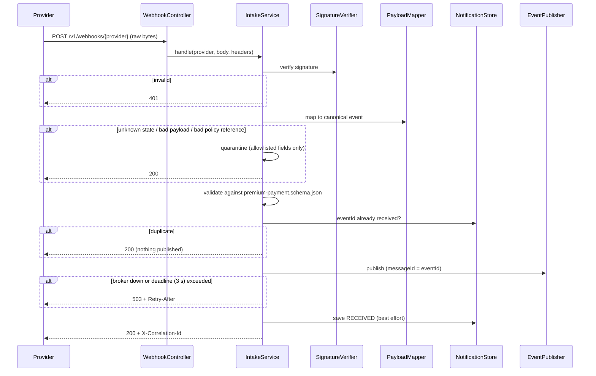

# Practical part — Payment notification intake (MX, CO)

`payment-intake` receives the webhooks of **Quetzal Pagos (MX)** and **Andina Pay (CO)**, verifies them, translates them into the canonical premium payment event, and publishes it durably **before** answering the provider. Writing to Salesforce is out of scope here (see `docs/design/SOLUTION_DESIGN.md` and ADR-0001).

It implements the contracts in [`docs/api/`](../docs/api/) and the decisions in [ADR-0002](../docs/adr/0002-implementation-stack-and-data-store.md) (Java 21 on Azure Container Apps) and [ADR-0003](../docs/adr/0003-webhook-acknowledgement.md) (2xx only after a durable publish).

## Stack and versions

| Item | Version |
|---|---|
| Java | 21 (built and tested with Microsoft Build of OpenJDK 21.0.13) |
| Spring Boot | 3.5.16 (web, actuator), with Tomcat 10.1.62 and Jackson 2.21.8 pinned for security fixes (see `pom.xml`) |
| Build | Maven 3.9.9 via the Maven Wrapper (`mvnw`): no Maven install needed |
| JSON Schema validation | `com.networknt:json-schema-validator` 1.5.9 (draft 2020-12) |
| Tests | JUnit 5, AssertJ, Spring MockMvc |

## How to build and run the tests

Requires only a JDK 21 (`JAVA_HOME` set). From this folder:

```bash
./mvnw verify          # Linux / macOS
.\mvnw.cmd verify      # Windows
```

`verify` compiles, runs the **107 tests** and packages the jar. Reports are in `target/surefire-reports/`.

Run one class or one method:

```bash
./mvnw test -Dtest=AndinaSignatureVerifierTest
./mvnw test -Dtest="AndinaSignatureVerifierTest#acceptsTheNextSecretDuringARotation"
```

Run the service locally (stubs only, nothing external is called):

```bash
INTAKE_WEBHOOKSECRETS_ANDINA_0=<sandbox secret> ./mvnw spring-boot:run
curl http://localhost:8080/actuator/health
```

## How the flow works



## Project structure

```
src/main/java/com/meridian/payments/intake/
├── api/          WebhookController: HTTP contract of docs/api/webhooks.openapi.yaml
├── core/         IntakeService: the flow above, identical for every provider
├── canonical/    PremiumPaymentEvent (+ builder), EventIds, Amounts, EventSchemaValidator
├── provider/     Interfaces shared by all providers: SignatureVerifier, PayloadMapper,
│   │             WebhookRequest, Hmac, PolicyNumbers, QuarantineReason
│   ├── quetzal/  Signature (t=…,v1=…, hex) and mapping (centavos, Unix time)
│   └── andina/   Signature (timestamp.body, Base64) and mapping (offset dates, referencia)
├── port/         Interfaces to external systems: EventPublisher, QuarantinePublisher,
│                 NotificationStore, SecretProvider
├── stub/         In-memory implementations of every port
└── config/       Clock
```

**Adding a provider** (NFR9): add a constant to `Provider`, one `SignatureVerifier`, one `PayloadMapper` and one endpoint. `IntakeService`, the canonical event and the ports do not change.

**Single source of truth.** The build copies the event schema from `docs/api/events/` and the provider samples from `reference/providers/` (see `pom.xml`). Code and tests always use the published contract and the official samples, never copies.

## What the tests prove

| Requirement | Evidence | Test class |
|---|---|---|
| **FR1** authenticity | All 7 official test vectors accepted; a changed byte, a wrong secret, the same JSON with CRLF line endings, a re-formatted Andina timestamp, an expired or future timestamp (exact boundaries), and missing or malformed headers are rejected; secret rotation works on both sides | `QuetzalSignatureVerifierTest`, `AndinaSignatureVerifierTest` |
| **FR2** canonical event | Every sample maps to an event that is **valid against the published JSON Schema**; centavos → major unit, `mxn` → `MXN`, Unix and `-05:00` → UTC; refunds carry the cumulative amount | `QuetzalPayloadMapperTest`, `AndinaPayloadMapperTest`, `PremiumPaymentEventTest` |
| **FR2** never guess | Unknown states, references that cannot be normalized, wrong currency, bad amounts and non-JSON bodies are quarantined, never defaulted; the INC-0412 references (`000215560`, `pol-co-000198004`) are normalized | same as above |
| **FR4** exactly once | Andina's retry (new `notificacion_id`) and Quetzal's redelivery (same `id`) are answered 200 and **not** published again; 8 identical deliveries in parallel, or with the store down, still produce one message (broker duplicate detection) | `IntakeServiceTest$Duplicates`, `WebhookControllerTest` |
| **NFR3** no loss | 200 only after the publish; broker down → 503 and nothing marked as received, so the provider's retry is accepted later; a failure after publishing still answers 200; a defect in our code answers 500, never 200 | `IntakeServiceTest$Durability`, `WebhookControllerErrorTest` |
| Producer strict | An event that passes the mapper but breaks the schema (a defect) is quarantined, never published | `IntakeServiceTest$Quarantine` |
| **NFR4** timeouts | Over the 3 s internal deadline → 503 before the provider times out | `IntakeServiceTest$Durability` |
| **NFR6** privacy | Event and logs never contain payer name, national id, email or policy number (logs are captured and checked); quarantine keeps allowlisted fields only; error messages never quote values; secrets only from the environment, with a rotation pair | `IntakeServiceTest`, `*PayloadMapperTest`, `PremiumPaymentEventTest`, `ConfiguredSecretProviderTest` |
| HTTP contract | 200 + `X-Correlation-Id`, 401/503 as `problem+json`, `Retry-After`, 413 over 256 KB, 404 for providers not in v1, raw bytes preserved through Spring | `WebhookControllerTest` |

## What is stubbed and how

Nothing external is called. Every external system is behind a port in `port/`, with an in-memory implementation in `stub/` that emulates the behaviour the design relies on:

| Port | Stub | Emulates | Production implementation (not built) |
|---|---|---|---|
| `EventPublisher` | `InMemoryEventPublisher` | Service Bus topic: **duplicate detection by `messageId`**, and outages | `azure-messaging-servicebus` sender to `premium-payment-events`, `DefaultAzureCredential` (managed identity, Data Sender role), send timeout within the 3 s budget |
| `QuarantinePublisher` | `InMemoryQuarantinePublisher` | `payments-quarantine` queue, and outages | Service Bus sender to `payments-quarantine` |
| `NotificationStore` | `InMemoryNotificationStore` | Cosmos DB `notifications` (status + attempts, SOLUTION_DESIGN §7.2), and outages | `azure-cosmos` with point read/create by `id` + partition key `paymentKey`, patch to append attempts |
| `SecretProvider` | `ConfiguredSecretProvider` | Secrets from **environment variables** only (`INTAKE_WEBHOOKSECRETS_<PROVIDER>_<n>`) | `azure-security-keyvault-secrets` with a managed identity, cached in memory with a short TTL so rotations are picked up |

The tests use the **fictional sandbox secrets** published in each `WEBHOOK_SPEC.md`, set only in test code and test properties. No secret is in `application.yml`.

## Known gaps

In priority order, what I would do next:

1. **Real Azure adapters.** Service Bus, Cosmos DB and Key Vault implementations of the ports, selected by Spring profile, with integration tests against the Service Bus and Cosmos DB emulators (Testcontainers).
2. **Austral (CL).** Not in scope for Part B. It needs a verifier (hex HMAC of the body, no timestamp, so replay protection relies on `eventId`), a mapper and an endpoint.
3. **Timeouts inside the adapters.** The 3 s deadline is checked before publishing; real clients also need per-call timeouts derived from the remaining budget.
4. **OpenAPI conformance test.** Status codes and headers are tested by hand against the contract. An automated check (for example a contract-test plugin) and a linter belong in CI (Part C).
5. **Observability.** Logs are `key=value` text and a Micrometer counter `intake.notifications{provider,outcome,reason}`. Production needs JSON logs, OpenTelemetry traces exported to Application Insights with the `correlationId`, and freshness metrics (`receivedAt` → recorded) per country.
6. **Unreadable bodies.** A body that is not JSON is quarantined with metadata only (no payload, because it cannot be sanitized), so it cannot be replayed from our side. Recovery requires the provider to resend it.
7. **Duplicates in quarantine.** The duplicate check needs an `eventId`, which a quarantined notification does not have. A provider duplicate of a quarantined notification is quarantined again; the replay tool must group quarantined messages by provider event id before replaying.
8. **Load test.** The design figures (40/s, about 50 ms per request) are not measured here.
9. **Migration to Spring Boot 4 (deadline 2027-03-31).** The first CI image scan found 40 HIGH/CRITICAL vulnerabilities, all in dependencies of Spring Boot 3.3.5. Spring Boot 3.5.16 plus pinned Tomcat and Jackson versions fixed 39. The remaining one, CVE-2026-47884 (RCE in `XsltView`), and one reported by the next scan on the upgraded version, CVE-2026-47890 (stream corruption in Server-Sent Events with views), are both in spring-webmvc and fixed only in Spring Framework 7. Neither is exploitable here, because the service has no view layer and no streaming responses, so both are accepted in `.trivyignore` until 2027-03-31; after that date the CI scan fails again. New spring-webmvc fixes are only being released for Spring Framework 7, which makes this migration (Spring Framework 7, Jackson 3) the top item of technical debt.

## Pitfall found while building

Git on Windows (`core.autocrlf=true`) converted the samples' line endings to CRLF on checkout. That changes the bytes, so **all 7 official signatures failed**. The repository's `.gitattributes` now marks the samples `-text`, and a test proves a CRLF body is rejected. It is the same reason the API Manager must forward the body byte for byte (assumption 8).
